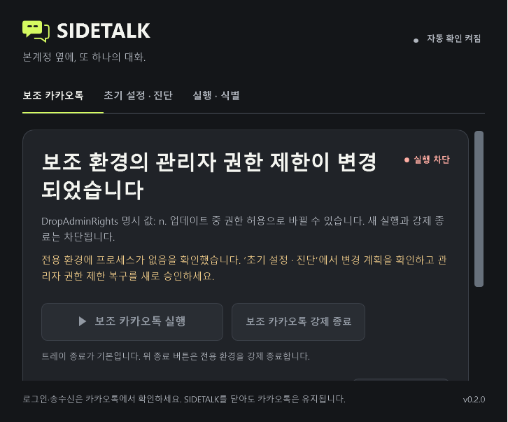
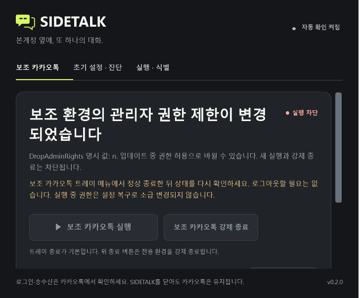
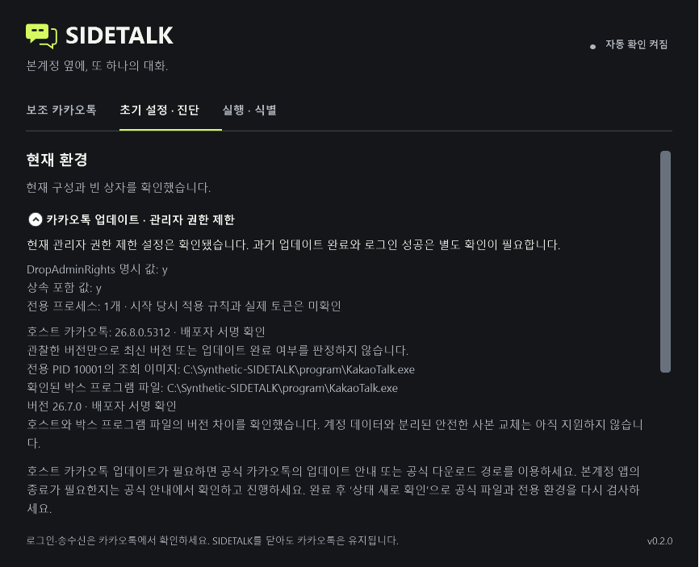

# 카카오톡 업데이트와 관리자 권한 제한 — 2026-10-07

작업 시작 시 깨끗한 로컬 main과 origin/main은 `0094252efc803240efed1361d0269dcdaced2e13`으로 같았다. 조용한 상태 확인·빠른 실행·사용자 바로가기·보조 창 식별·기존 중단 복구를 유지하면서 별도 브랜치에서 구현했다. 설치본 교체와 main 병합은 수행하지 않는다.

## 확인한 원인과 현재 관찰의 한계

Sandboxie 1.18.4의 [SBIE2220 처리](https://github.com/sandboxie-plus/Sandboxie/blob/v1.18.4/Sandboxie/apps/control/MessageDialog.cpp#L703-L719)는 확인 버튼을 승인하면 `GetSetDropAdminRights(TRUE, FALSE)`를 호출한다. [설정 구현](https://github.com/sandboxie-plus/Sandboxie/blob/v1.18.4/Sandboxie/apps/control/Box.cpp#L1389-L1399)은 false일 때 해당 박스의 `DropAdminRights` 값을 비운다. 따라서 권한 허용 동작으로 필수 제한 값이 사라질 가능성은 공식 소스로 확인했다. 이것이 이번 사용자가 누른 버튼 또는 현재 설정을 증명하지는 않는다. SBIE2217·2219·2220 메시지와 로그인 성공만으로 관리자 토큰, 업데이트 완료, 격리 전체 해제, 데이터 유출을 판정하지 않는다.

`DropAdminRights=y`는 [관리자 그룹을 제거하는 제한](https://sandboxie-plus.github.io/sandboxie-docs/Content/DropAdminRights.html)이다. [설정 reload](https://sandboxie-plus.com/sandboxie/startcommandline/)는 이미 실행 중인 프로세스에 소급 적용되지 않는다. SIDETALK는 실행 중 프로세스의 실제 토큰 또는 시작 당시 모든 규칙을 새 기능에서 검증했다고 주장하지 않는다.

현재 PC에서 기존 코드와 최종 코드의 `--diagnose`를 읽기 전용으로 실행했다. 호스트 카카오톡의 검증된 버전은 `26.8.1.5315`, Sandboxie는 `1.18.4`였다. 그러나 현재 Codex 실행 문맥에서는 `HostProfileContext`가 다음 이유로 조회를 차단했다.

> SIDETALK 프로필 경로가 다른 실제 위치로 연결되어 있습니다. 시작 메뉴의 SIDETALK로 다시 열어 확인하세요.

따라서 실제 전용 박스의 소유·물리 저장 경로, `DropAdminRights` 명시/상속 값, 프로세스, 박스 프로그램 사본, 미완료 명령·복구 여부는 **미확인**이다. 임의로 실제 프로필 경로를 주입하거나 보호 검사를 우회하지 않았다. 계정 데이터·대화·토큰·암호를 읽지 않았다. 진단 출력 파일만 저장했으며 원본 보고서의 사용자 경로·SID 등은 커밋하지 않는다. 프로필 경로 오류의 구체적인 원인을 MSIX 가상화로 단정하지 않는다.

## 앱 내 진단과 복구

정책 불일치는 새 실행·종료를 계속 차단한다. 소유 표식과 API의 실제 저장 루트를 먼저 검증한 경우에만 불일치 상태에서도 읽기 전용 프로세스·프로그램 이미지 증거를 수집한다. 조회 실패는 빈 박스의 증거가 아니다. 이 진단은 명령을 재조정하거나 저널을 완료 처리하지 않는다.

| 현재 관찰 | 표시와 동작 |
|---|---|
| 명시·상속 포함 값 모두 `y`, 기존 정책 안전 | 현재 제한 확인. 불필요한 복구 쓰기·백업 없음. 과거 업데이트와 로그인 결과는 별도 확인 |
| 값 누락·빈 값·단일 `n` | 현재 값과 가능한 권한 허용 원인을 표시. 새 실행·강제 종료 차단 |
| 중복·프로세스별·미검토 값, 상속 불일치, 다른 정책 차이 | 제한 복구로 덮어쓰지 않고 차단 이유 유지 |
| 정확한 KakaoTalk.exe 실행 중, 또는 잔여와 혼재 | 보조 카카오톡 트레이의 정상 종료 안내. 로그아웃·계정 삭제 불필요. 강제 종료 또는 복구 강행 없음 |
| 검증된 잔여 exe만 존재 | 이름·PID와 전용 **잔여 프로세스 정리 후 복구** 안내. 일반 CanStop 차단은 유지하고 별도 일회용 승인을 요구 |
| 프로세스 조회 실패 | 미확인으로 표시. 빈 환경 확인 전 복구 차단 |
| 검증된 빈 전용 박스와 승인 가능한 계획 | 초기 설정 · 진단의 **관리자 권한 제한 복구**에서 현재 계획을 새로 확인·승인 |

위 잔여 프로세스 구분과 전용 정리는 후속 변경이다. 정확한 단일 제한 차이·삭제 방지 설정·관리 UI 없음·공식 box 명령·종료 코드 0과 fresh empty 확인·같은 범위 복구 및 새 검증 결과는 [RESIDUAL-BOX-RECOVERY.md](RESIDUAL-BOX-RECOVERY.md)를 따른다. 아래 272개 검사 기록은 최초 관리자 권한 복구 작업 당시 결과다.

새 보안 복구의 추가 변경은 기존 소유 박스의 **`DropAdminRights`만 `y`로 설정**하는 것이다. 알 수 없는 다른 정책 차이는 수정하지 않는다. 이미 지원하던 여섯 전역 Template 선택 제거와 현재 사용자 옵션은 별도의 검증·승인 항목이 실제 계획에 있을 때만 기존 기준을 따른다. 다른 박스가 있으면 기존 전역 변경 보호를 유지한다. 제한 복구를 핑계로 전역 또는 다른 박스 변경을 추가하지 않는다.

이 제한 복구는 기존 자동 동의로 적용할 수 없고, UI에서도 자동 동의 선택을 숨긴다. 기본 취소인 확인 창에서 현재 변경 목록과 영향 범위를 승인해야 한다. 앞으로의 자동 복구 동의를 새로 저장하지 않는다. 적용은 공유 CommandJournal 잠금, 미완료 작업 검사, 계획·현재 값·소유·경로 재검증, 백업, 검증된 공식 SbieIni 실행, 변경마다 파일/API 재조회, 원래 엄격한 격리 정책의 최종 검사 순서로 진행한다. 종료 코드 0만으로 성공 처리하지 않는다. 승인 후 설정 경합·부분 실패·재시작에서는 원래 오류와 작업 기록을 보존하며 차단 상태를 유지한다. 전체 INI 복원·프로필 재생성·계정 초기화는 수행하지 않는다.

메인 화면은 현재 차단 원인과 정상 종료/새 승인 안내를 보여준다. 상세 값·프로그램 증거는 초기 설정 · 진단의 **카카오톡 업데이트 · 관리자 권한 제한**에서 확인한다. 변경 없는 자동 조회는 기존 조용한 동작을 유지하며 실제 차단·실패·복구 진행을 숨기지 않는다.

## 공식 업데이트 경로와 지원하지 않는 경우

카카오의 [공식 PC 배포 안내](https://pc.kakao.com/talk/notices/ko/2882?agent=win32)를 확인했고 앱은 기존 [카카오톡 공식 안내](https://www.kakaocorp.com/page/service/service/KakaoTalk)를 여는 버튼을 제공한다. 호스트 공식 앱의 업데이트 안내 또는 공식 다운로드를 사용자가 직접 선택해 진행하는 경로다. 본계정 앱의 종료나 시스템 변경이 필요하면 그 공식 안내의 영향을 확인하고 승인해야 한다. 완료 후 SIDETALK의 상태 새로 확인으로 공식 파일·전용 환경을 다시 검사한다. SIDETALK가 업데이트를 실행하거나 본계정을 종료하지 않는다.

검증된 공식 자동 업데이트 CLI·무인 설치 인터페이스를 이번 조사에서 확보하지 못했으므로 이를 발명하지 않는다. 권한 제한을 잠시 풀었다 다시 켜기, 비공식 업데이트 차단, 카카오톡 패치·주입·후킹은 추가하지 않는다.

실행 이미지 증거는 소유 API가 확인한 전용 KakaoTalk PID의 생성 시각과 실제 조회 경로를 재확인한다. 그 경로가 검증된 전용 저장 루트 안의 정확한 `KakaoTalk.exe`이고 reparse·최종 물리 경로 검사를 통과할 때만 해당 프로그램 파일의 버전·배포자 서명을 읽는다. 계정 저장소를 재귀 탐색하거나 Sandboxie drive 매핑 경로를 추측하지 않는다. 논리 호스트 경로만 조회되면 실제 사용하는 가상화 사본은 **미확인**이다. 호스트 경로 표시는 박스 사본의 부재를 증명하지 않는다.

버전 차이는 물리 파일·배포자와 두 버전을 모두 확인한 경우에만 사실로 표시한다. 읽지 못한 버전은 차이로 단정하지 않는다. 호스트가 갱신돼도 모든 박스 사본이 자동 갱신됐다고 판단하지 않는다. 안전한 데이터 경계·백업·롤백을 입증한 박스 사본 교체는 이번 변경에서 지원하지 않으며 삭제·동기화·계정 파일 복사를 수행하지 않는다. 파일 버전이 같거나 로그인 가능해도 과거 업데이트 완료를 선언하지 않는다.

## 검증 근거와 남은 범위

최종 `pwsh -NoProfile -File scripts/verify.ps1 -UiChecks`는 Release 앱·IsolationProbe 빌드(경고/오류 0), 콘솔 **272/272**, 관리자 권한 WPF **6개**, 기존 상호작용 **16개**·빠른 실행 **20개**·조용한 조회 **15개** 및 production 타이머 **24초** 관찰이 통과했다(98.44초, 종료 코드 0). 초기 통합 검사의 기존 검증 범위 계약 실패를 고쳤으며 미검증 정책 조회에서 미완료 기록이 없다는 이유로 `CommandPending=false`를 부여하지 않는다. 마지막 버전 미확인 보정과 UI 문구·실제 메인 탭 캡처 보정 후 통합 검증을 재실행한 결과를 [VERIFICATION.md](VERIFICATION.md)에 기록했다.

새 콘솔 26개는 정상 `y`의 쓰기 0, 누락/n·실행 차단, 클릭 이력 추정 금지, 실행 중/조회 실패 차단, 새 승인·이전 자동 동의 거부, 기타 정책 보존, 백업·종료 코드 0 무변경 실패, 경합·부분 실패·새 인스턴스 재조정, 합성 프로필·계정 sentinel·기존 기록 보존, 진단/렌더 쓰기 0, 물리 파일 경계·버전 미확인을 검사한다. 합성 파일의 보존 결과를 실제 계정 DB의 실측 결과로 확대하지 않는다.

아래는 실제 WPF로 렌더한 **합성** 상태다. 기본/최소 창의 원인·승인 문구·차단 안내·스크롤 가독성을 확인했다.

이번 작업에서 승인된 별도 Windows/Sandboxie 통합 시험 환경을 사용하지 않았다. 실제 DropAdminRights 변경·실제 SbieIni 제한 복구·보조 업데이트·본계정 종료·로그인·송수신은 **미수행**이다. 현재 사용자의 로그인 성공을 새 기능 통합 검증으로 재사용하지 않는다. `artifacts/vm-lab`과 실제 설치본·프로필·Sandboxie 설정은 변경하지 않았다. 설치/빌드 스크립트 변경이 없어 BuildChecks·InstallerChecks와 설치 패키징은 실행하지 않았다. 원격 CI는 workflow_dispatch만 지원하며 이번 작업에서는 실행하지 않았다.
