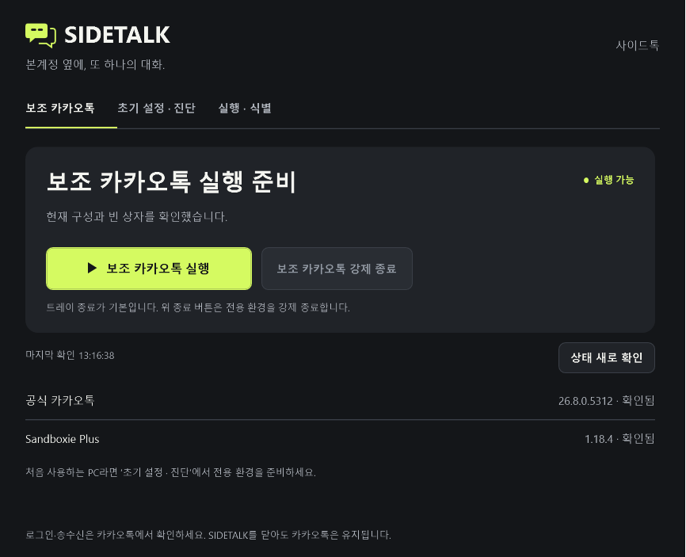
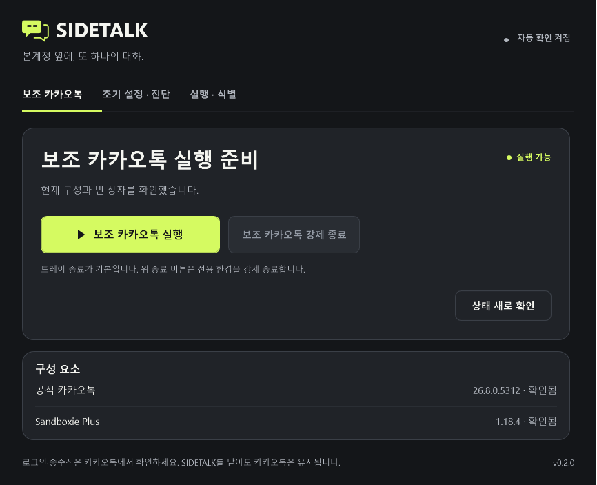

# 조용한 상태 확인과 메인 UI — 2026-10-07

기준은 최신 `origin/main` / 시작 HEAD `72c2fc1d02d6c644cab0a91e33d93296262e690a`다. 시작 작업 트리는 깨끗했고 별도 `codex/quiet-status-ui` 브랜치에서 구현했다.

## 표시와 실행 권한

메인 화면은 기존 가로 탭과 Windows 창 동작을 유지한다. 실행/강제 종료와 낮은 우선순위의 수동 확인을 하나의 실행 카드에 두고, 구성 요소 두 행을 구분선이 있는 카드로 묶었다. 메인의 최초 설정 안내는 `SetupRequired` / `MissingDependency`일 때만 표시한다. 진단 탭의 접힌 `설치 · 수동 설정`에는 상세 도움말, 공식 링크와 전용 INI 내보내기를 계속 제공한다. 제품 버전은 `SidetalkBuild.Version`에서 읽는다.

정기 조회는 기존 4초 `DispatcherTimer`와 같은 controller 호출을 유지한다. 조회 시작/대기/동일 결과 완료에 진행 문구를 더하지 않는다. 중립색의 고정 `자동 확인 켜짐`은 조회 활성화만 뜻한다. 실제 성공 응답의 `CheckedAt`은 툴팁, 키보드 포커스 도움말과 진단의 상세 정보에서 확인한다. 상태·복구·중단 흔적 조회 실패는 성공 시각과 별도로 기록하며 재시도 시작으로 지우지 않는다. 실행/복구/중단 흔적 관찰을 모두 받은 뒤 표시를 반영하고 같은 검사 목록은 다시 만들지 않는다.

수동 확인은 진행 중인 자동 조회 Task에 합쳐지고 한 요청만 유지한다. 300ms 이상 걸릴 때 고정 폭의 버튼 안에만 `확인 중…`을 표시한다. 완료/실패/최소화/닫힘은 지연 표시를 취소한다. 실제 실행·종료·복구의 진행과 결과는 메인 카드의 예약된 안내 영역과 기존 진단 UI에 표시한다. 복구 progress callback은 현재 operation과 generation일 때만 반영한다.

표시된 이전 관찰은 실행 권한이 아니다. 조회 시작 시 `_lastSnapshot`을 비우고, 실행 요청 접수 후 활성 조회 완료·사용자 확인·명령 직전 새 조회를 거친다. 기존 `CanRequestAction`, intent/inspection generation, controller gate와 CommandJournal은 그대로 사용한다. Core 정책, Sandboxie 기준/설정, SDK와 설치 스크립트는 변경하지 않았다. 진단의 변경 작업은 기존 조회 중 차단 조건을 유지한다.

## 실제 WPF 화면

이미지는 production XAML/컨트롤을 Windows에서 렌더한 **합성 외부 경계의 WPF 클라이언트 영역**이다. 기준 화면도 해당 main 소스를 임시로 빌드해 같은 fixture 방식으로 렌더했다. 설치된 앱이나 실제 계정 화면의 캡처가 아니다. 구성 요소 버전/경로는 fixture 데이터이며 제품 UI에는 하드코딩하지 않는다.

| 이전 | 변경 후 실행 준비 |
|---|---|
|  |  |

| 상태 | 기본 크기 | 최소 크기 |
|---|---|---|
| 최초 확인 중 | [화면](images/quiet-status-ui/quiet-initial-default.png) | [화면](images/quiet-status-ui/quiet-initial-min.png) |
| 실행 준비 | [화면](images/quiet-status-ui/quiet-ready-default.png) | [화면](images/quiet-status-ui/quiet-ready-min.png) |
| 실행 중 | [화면](images/quiet-status-ui/quiet-running-default.png) | [화면](images/quiet-status-ui/quiet-running-min.png) |
| 조회 실패 | [화면](images/quiet-status-ui/quiet-error-default.png) | [화면](images/quiet-status-ui/quiet-error-min.png) |
| 수동 확인 진행 | [화면](images/quiet-status-ui/quiet-manual-default.png) | [화면](images/quiet-status-ui/quiet-manual-min.png) |
| 실제 복구 경로 진행 | [화면](images/quiet-status-ui/quiet-recovery-default.png) | [화면](images/quiet-status-ui/quiet-recovery-min.png) |

## 검증 경계

검증 명령은 `pwsh -NoProfile -File scripts/verify.ps1 -UiChecks`다. 기존 콘솔 러너와 WPF 회귀를 유지하면서 제어된 Task로 세 자동 조회 주기의 시작·대기·성공, 수동 지연 표시·합치기·중복·실패·취소, 오류 유지/해제와 자동 복구 안내를 확인한다.

기본 880×740 / 최소 740×640 DIPs의 production WPF 렌더와 100/125/150/200% RenderTargetBitmap 확대 렌더를 구분한다. 확대 렌더는 실제 모니터 설정 변경이나 모니터 간 `WM_DPICHANGED` 전환 시험을 대신하지 않는다. 실제 Sandboxie 설정 변경, 관리 UI 종료, 카카오톡 실행·로그인·송수신, 사용자 설치본 교체는 수행하지 않는다.

원격 CI는 기존 `workflow_dispatch` 정책을 유지한다. 이번 UI PR의 로컬 결과를 과거 CI 성공이나 실계정 검증으로 대체하지 않는다.

## 현재 소스의 실행 결과

| 검사 | 결과 |
|---|---|
| Release 앱 / IsolationProbe 빌드 | 통과, 경고·오류 0 |
| 콘솔 안전성 회귀 | 246/246 통과 |
| 기존 WPF 상호작용 | 16개 동기화 시나리오 통과. 조회 중 실행/종료 버튼 왕복 변경 0, 접수한 실행 1, 최소화 snapshot 표시 갱신 0 |
| 빠른 실행 WPF | 20개 동기화 시나리오 통과 |
| 조용한 상태 확인 WPF | 15개 묶음 통과. 세 주기의 제어된 시작·대기·성공, 수동 합치기/중복/지연 취소, 오류 유지/해제, 복구 결과 미검증 차단, 6상태 렌더와 DPI 검사 포함 |
| production 타이머 관찰 | 24초, 219회 표본, 총 조회 8회(초기·준비 조회 포함), 표시·배치·포커스·선택·스크롤 위반 0. [관찰 기록](images/quiet-status-ui/observation.json) |
| 기본 / 최소 창 | 880×740 / 740×640 DIPs. 6상태의 실행·강제 종료·수동 확인 버튼 경계 검사와 한국어 오류 줄바꿈 확인. 최소 창의 보조 내용은 세로 스크롤로 접근 |
| 원격 GitHub Actions | 이번 변경에 dispatch하지 않음. push/PR 자동 실행은 기존 정책에 없음 |

`verify.ps1 -UiChecks`에서 앱·콘솔·시험 도구 단계는 통과했고, WPF의 24초 관찰은 창 초기 포커스가 안정화되기 전 기준을 잡아 실패했다. 이 실패를 성공으로 기록하지 않았다. 창 Loaded/포커스 복원 처리를 dispatcher idle까지 기다리고 수동 확인 버튼에 명시적으로 포커스를 둔 후 기준을 잡도록 **검사 harness**를 수정했다. 포커스 유지 assertion과 관찰 시간은 그대로다. 수정 후 다음 전체 WPF 명령이 종료 코드 0으로 통과했다. Core와 빌드/설치 스크립트는 변경하지 않아 앞서 통과한 콘솔 검사를 불필요하게 다시 실행하지 않았다.

```powershell
dotnet run --project tests/Sidetalk.UiChecks/Sidetalk.UiChecks.csproj -c Release -- artifacts/quiet-ui-captures
```

로그는 로컬 `artifacts/verification/quiet-ui/final-verify.log`(단계별 결과와 실패), `final-ui-checks.log`(수정 후 WPF 전체 성공)에 보존했다. 확인용 임시 소스·캡처 폴더는 정리했고 아래 이미지와 작은 관찰 기록만 문서에 남겼다.

| 확대 렌더 | 기본 창 | 최소 창 |
|---|---|---|
| 100% / 96dpi | [이미지](images/quiet-status-ui/quiet-dpi-1x-default.png) | [이미지](images/quiet-status-ui/quiet-dpi-1x-min.png) |
| 125% / 120dpi | [이미지](images/quiet-status-ui/quiet-dpi-1_25x-default.png) | [이미지](images/quiet-status-ui/quiet-dpi-1_25x-min.png) |
| 150% / 144dpi | [이미지](images/quiet-status-ui/quiet-dpi-1_5x-default.png) | [이미지](images/quiet-status-ui/quiet-dpi-1_5x-min.png) |
| 200% / 192dpi | [이미지](images/quiet-status-ui/quiet-dpi-2x-default.png) | [이미지](images/quiet-status-ui/quiet-dpi-2x-min.png) |

8개 PNG의 실제 픽셀 크기·dpi와 WPF DIP 배치를 검사했다. [크기 기록](images/quiet-status-ui/dpi-probes.json)의 200% 이미지는 기본 1731×1406 / 최소 1451×1206 픽셀이다. 이 이미지는 실제 확대 `RenderTargetBitmap`이며, 모니터 DPI 변경·모니터 간 이동 시험은 미수행이다. 실제 화면 읽기 프로그램의 음성 출력도 시험하지 않았으며, 주기적 상세 정보의 live setting OFF와 키보드 툴팁 접근·동일 표시 유지의 WPF 검사를 수행했다.
