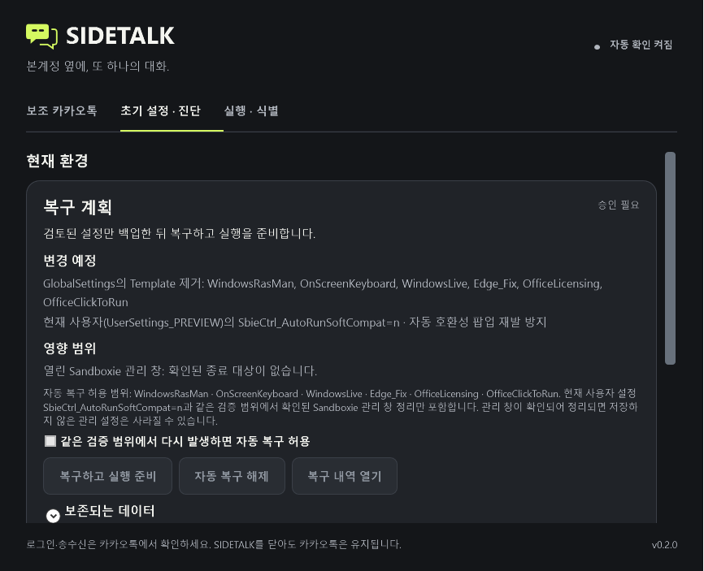
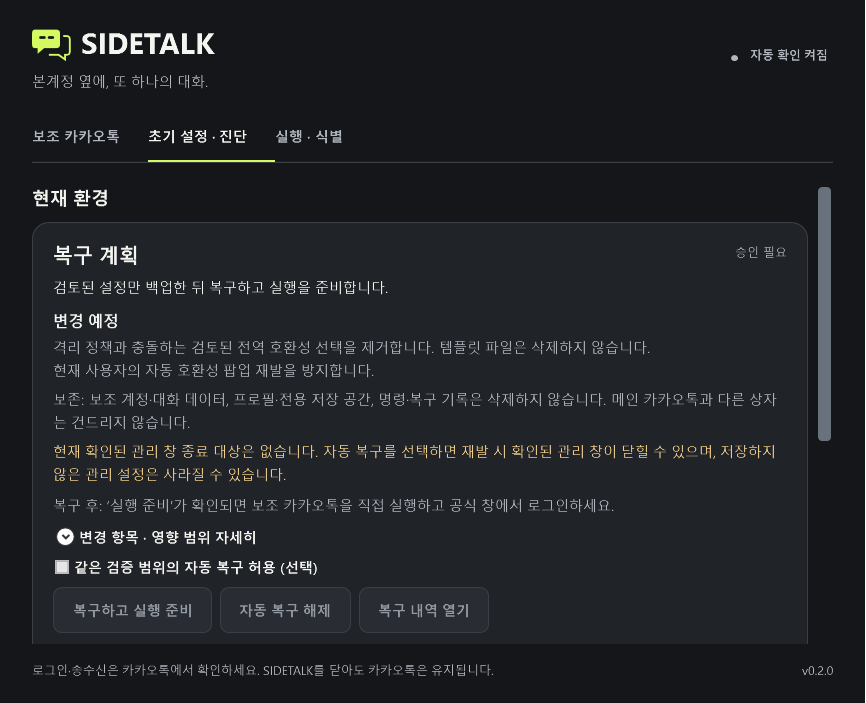

# 복구 승인 화면 — 2026-10-13

기존 복구 계획 패널을 유지하고 승인 전에 읽는 순서를 개선했다. 복구 이유는 현재 계획 요약으로, 변경 목적은 기술 식별자를 나열하기 전에 쉬운 문장으로 설명한다. 보조 계정·대화 데이터, 프로필·전용 저장 공간과 명령·복구 기록을 삭제하지 않는다는 요약, 저장하지 않은 관리 설정의 손실 가능성, 복구 후 직접 실행·로그인할 행동이 승인 버튼 위에 표시된다.

`변경 항목 · 영향 범위 자세히`를 펼치면 실제 변경 계획, 정확한 template identifier, 현재 사용자 `SbieCtrl_AutoRunSoftCompat=n`, 확인된 관리 창 종료 대상과 기존 자동 복구 허용 범위를 볼 수 있다. `보존되는 데이터`, 복구 내역 열기, 백업 위치, 중단 흔적의 별도 보존 내역 경로를 유지한다. 자동 복구 선택은 기본 꺼짐이며 기존 동의 저장·해제 계약을 사용한다. 관리자 권한 제한 복구는 별도 새 승인이 필요하고 기존 자동 동의를 사용하지 않는다.

준비, 실행, 재검사, 원본 보존, 자동 복구 해제는 구분한다. 실행 실패와 상태 조회 실패도 구분한다. 중간 실패 시 일부 설정이 적용됐을 수 있음을 안내한다. 엔진의 현재 설정·백업 보존 근거를 그대로 표시하며 변경 전 상태로 복원됐다고 주장하지 않는다. 복구 검증 후 선택적 자동 동의 저장만 실패한 결과도 원래 detail을 보존한다. 미확인 결과는 성공 안내로 바꾸지 않는다.

## 검증 범위

- 합성 WPF: 승인 전 정보 순서, 정확한 상세 식별자, 관리 창 대상 유/무, 새 승인과 자동 동의 배제, 진행·조회 실패·적용 실패·검증 완료와 선택적 동의 저장 실패를 확인한다.
- 합성 키보드: WPF routed KeyDown/KeyUp으로 Space 선택 켜기/끄기, Tab의 승인 버튼 이동, 포커스된 Enter의 합성 복구 1회, 다른 컨트롤의 Enter 및 Esc의 승인·쓰기 방지를 확인한다. 실제 OS 입력 주입 검증과 구분한다.
- 합성 화면: 기본 880×740, 최소 740×640, 1.5배 확대와 스크롤 접근을 확인한다. 확대는 Windows 텍스트 크기 설정을 변경한 실환경 증거가 아니다.
- 실제 Windows High Contrast: 미검증. 현재 고대비는 꺼져 있었고 설정 앱이 대상 창을 제공하지 않았다. 합성 검사 창에 대한 Computer Use 접근 승인도 시간초과했다. OS 고대비의 글자·버튼·경고·focus를 PASS로 판정하지 않는다.
- `App.xaml`의 본문 브러시는 고정 StaticResource이고 `WindowAppearance.cs`의 고대비 분기는 native caption에 한정됨을 코드에서 확인했다. 실제 OS에서 본문 문제가 확인되지 않았으므로 이 작업에서 리소스를 변경하지 않았다. 이 검토는 본문의 고대비 적응을 보장하지 않는다.
- 복구 엔진, template 적용, process ownership, Run/Stop 경로는 변경하지 않았다. 실제 복구 명령·설치·계정 동작은 실행하지 않았다.

수정 전후와 최소 창·큰 글자·focus 화면은 `images/recovery-approval/`에 보존한다. 모든 복구 내용은 합성이며 실제 설치·사용자 계정의 관측 결과가 아니다.

| 수정 전 | 수정 후 |
|---|---|
|  |  |

[큰 글자와 스크롤 접근](images/recovery-approval/large-text.png), [최소 창의 승인 버튼 focus](images/recovery-approval/keyboard-focus.png), [관리 창 종료 대상이 있는 경고](images/recovery-approval/manager-warning.png).

로컬 전체 검증은 166.38초에 통과했고 Release 경고·오류 0개, 콘솔 324/324, 기존 WPF 회귀와 새 승인 회귀가 통과했다. 홈/복구 단계 동기화·자동 동의 해제·확대 캡처 보완 후 좁은 승인 회귀도 통과했다. 로그는 `artifacts/verification/recovery-approval/verify.log`, `approval-final.log`에 남긴다. 원격 CI, BuildChecks, InstallerChecks는 이 UI 작업에서 실행하지 않았다.

검증 명령:

```powershell
dotnet run --project tests/Sidetalk.UiChecks/Sidetalk.UiChecks.csproj -c Release -- artifacts/recovery-ui-checks --approval-only
pwsh -NoProfile -File scripts/verify.ps1 -UiChecks
```

합성 native 창을 직접 열어 추가 확인할 때는 동일 테스트 프로그램의 `--approval-preview`를 사용한다. 실제 컨트롤러를 생성하지 않으며 창을 닫으면 종료한다. 이 창에서 수행한 동작은 실제 Sandboxie 복구의 증거가 아니다.
