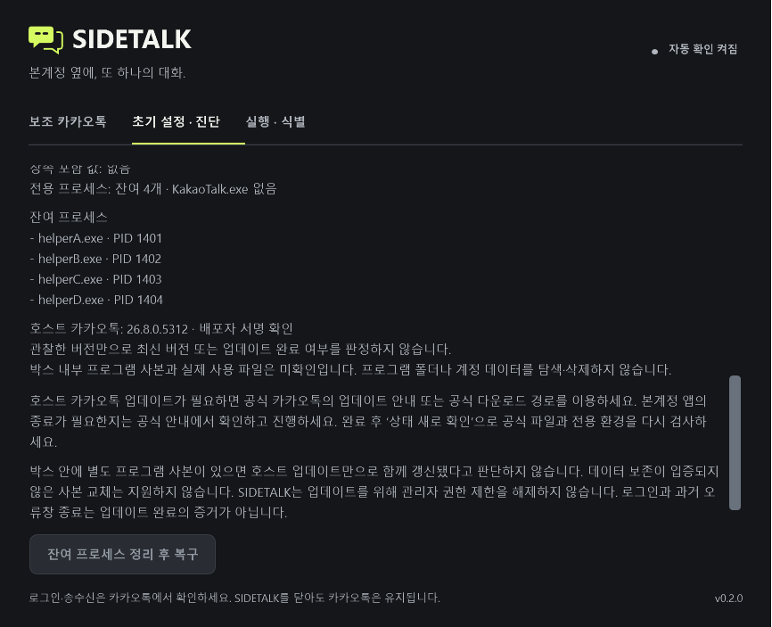
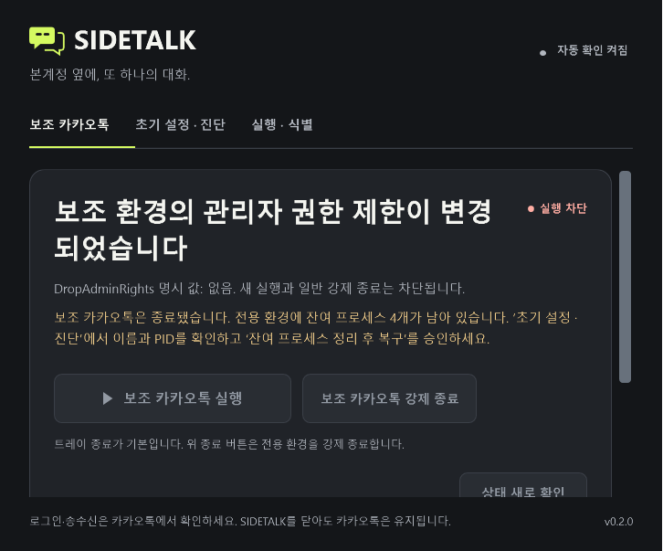
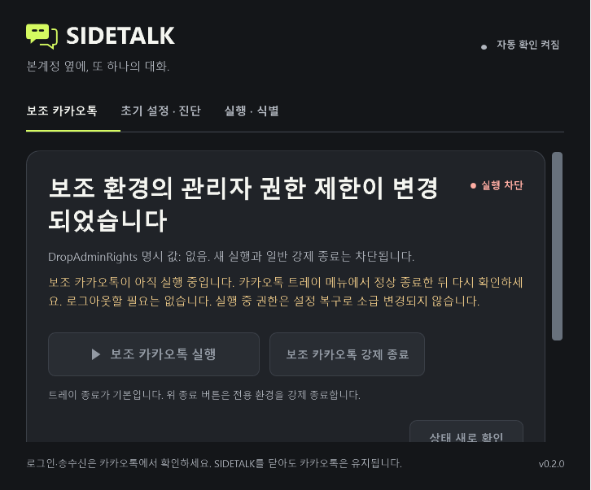
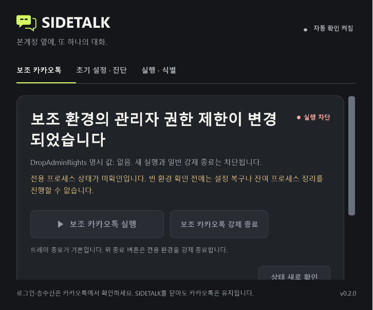

# 잔여 프로세스 정리와 관리자 권한 제한 복구 — 2026-10-07

작업 시작 시 깨끗한 main과 origin/main은 `ce625661e94cd232e95135f5144b552e5a55b951`으로 같았다. `codex/residual-box-recovery`에서 기존 관리자 권한 제한 복구를 확장했다. main 병합·설치본 교체·패키징은 이번 작업에 포함하지 않는다.

## 원인과 관찰 범위

사용자가 제공한 진단은 `DropAdminRights` 명시/상속 값 누락, `SetupRecovery=Blocked`, 박스 프로세스 4개, `AdminRights.Images=[]`, `CanLaunch=false`, `CanStop=false`, `CurrentConfigurationVerified=false`였다. 사용자는 카카오톡을 트레이에서 이미 종료했다고 설명했다. 기존 코드는 박스의 모든 프로세스를 카카오톡 실행으로 취급해 정상 종료 안내를 반복했다. `Images=[]`는 정확한 KakaoTalk.exe 이미지 증거 목록이 비었다는 뜻이며 박스 전체가 비었다는 증거가 아니었다.

이번 합성 재현은 `helperA.exe`부터 `helperD.exe`까지 4개가 남고 KakaoTalk.exe는 없는 상태다. 실제 사용자 프로세스 이름·SID·경로·계정 내용은 fixture나 커밋에 넣지 않았다. 현재 PC에서는 최종 코드의 `--diagnose`를 읽기 전용으로 실행했지만 다음 호스트 보호 검사로 실제 박스 조회가 차단됐다.

> SIDETALK 프로필 경로가 다른 실제 위치로 연결되어 있습니다. 시작 메뉴의 SIDETALK로 다시 열어 확인하세요.

현재 실제 박스의 프로세스와 제한 값은 미확인이다. 보호 경계를 우회하지 않았고 사용자 Sandboxie 설정·프로필·계정·배포 앱을 변경하지 않았다. 이 진단은 출력 보고서만 생성했다. 사용자 제공 진단과 합성 재현을 현재 PC에서의 실제 종료 성공으로 확대하지 않는다.

## 표시와 권한

| fresh 박스 관찰 | 표시와 가능한 동작 |
|---|---|
| 정확한 KakaoTalk.exe 존재, 또는 잔여와 혼재 | 보조 카카오톡 트레이의 정상 종료 안내. 정리 승인 없음 |
| 신원이 확인된 다른 exe만 존재 | 잔여 개수·이름·PID 표시. 아래 모든 조건을 만족할 때 **잔여 프로세스 정리 후 복구** 제공 |
| 프로세스 없음 | 기존의 새 명시적 관리자 권한 제한 복구 |
| PID만 존재, 이름/SID/중복 PID 오류, 조회 실패 | 미확인으로 표시하고 정리·복구 차단. 빈 박스로 간주하지 않음 |

`AdminRightsObservation.BoxProcesses`는 이름·PID·세션·신원 확인 여부를 담는다. 정확한 KakaoTalk.exe 수, 잔여 수, 미확인 수와 `ProcessState`를 따로 계산한다. 프로그램 버전 증거인 기존 `Images`와 혼동하지 않는다. 진단의 프로세스 DTO에는 SID·계정 내용·명령행을 넣지 않는다. SetupRecovery 진단에는 현재 정리 승인 발급 가능 여부도 기록한다.

정책 불일치의 일반 `CanLaunch/CanStop` 차단은 유지한다. 정상 정책의 helper-only 박스는 기존 일반 종료 계약을 유지한다. 새 정리 권한은 일반 Stop 권한으로 전환되지 않으며 현재 controller가 발급한 불투명한 일회용 승인 객체만 받는다. 이전 자동 복구 동의를 사용하거나 새 자동 동의를 저장하지 않는다.

## 정리와 복구의 좁은 범위

승인 발급·클릭 후·명령 직전·정리 후·설정 적용 전에 현재 사용자 문맥, 프로필/소유 표식/SID, API의 실제 저장 루트, 고정 Sandboxie 1.18.4 설치와 공식 명령 파일을 재검증한다. Start.exe 등 설치 파일의 서명·버전·해시 검사는 기존 검증을 재사용한다. 프로세스 조회 성공과 정확한 이름·양수 PID·현재 소유 SID·중복 없음이 필수다. helper 이름 allowlist 또는 이름만으로 종료할 프로세스를 선택하지 않는다.

허용하는 설정 차이는 기존 소유 박스의 `DropAdminRights` 누락·빈 값·단일 `n`뿐이다. 메모리에서 이 값만 `y`로 바꾼 구성으로 **기존 엄격한 정책 검사 전체**가 통과해야 한다. 실제 명시/상속 박스 구성은 같아야 하며, 전역/상속 규칙을 완화하지 않는다. 데이터 보호 설정 `AutoDelete=n`, `NeverDelete=y`, `AutoRecover=n`도 명시적으로 확인한다. 첫 준비·중단 복구·전역 Template 변경·다른 설정 변경이 함께 필요한 계획, 미완료 명령, 열린 관리 UI는 이 전용 정리 경로를 차단한다.

확인 창은 기본 취소이고, 전용 box 이름·현재 잔여 이름/PID·정리와 동일한 단일 `DropAdminRights=y` 복구 범위를 한 번 승인한다. 승인 후 프로세스 집합이 달라지면 명령을 보내지 않고 새 승인을 요구한다. 관리 UI가 처음부터 있거나 정리/복구 도중 나타나면 차단한다. 관리 UI·호스트 카카오톡·서비스·드라이버를 종료하지 않는다.

정리는 기존 `SandboxieCommands.Stop`이 만든 검증된 공식 Start.exe의 `/silent /box:<정확한 소유 box> /terminate`만 사용한다. [공식 명령 문서](https://sandboxie-plus.com/sandboxie/startcommandline/)의 전용 box 종료 기능을 사용하며 `/terminate_all`, 기본 box 종료, OS kill, DeleteContent, 설정 초기화는 추가하지 않는다. 자동 삭제를 막는 정책을 확인하더라도 모든 외부 수동 삭제나 환경 변경에 대한 절대적 데이터 보존 보장을 주장하지 않는다.

공유 CommandJournal 잠금 아래 **프로세스 생성 전** `RecoveryBoxCleanup` 의도를 영속 기록한다. 승인 범위와 관찰한 프로세스 집합의 SHA-256 fingerprint, 실제 Start.exe PID·생성 시각·경로를 기존 기록 계약에 결합한다. 중복 호출은 명령을 한 번만 생성한다. 명령 종료를 확인한 뒤 박스를 250ms 간격으로 최대 12초 재조회한다. **알려진 종료 코드 0과 fresh empty가 모두 확인된 경우만** 정리 성공으로 처리한다. 잔여 유지·timeout·새 KakaoTalk.exe·조회 실패·소유/설정/설치/관리 UI 변경이면 설정을 쓰지 않는다.

성공 후에도 fresh 빈 계획과 동일한 원래 승인 범위를 다시 확인한다. 기존 SetupRecovery의 백업·fingerprint·공식 SbieIni·파일/API 재조회·최종 엄격한 정책 검사를 그대로 사용해 단일 제한 값만 복구한다. 전체 INI 롤백·프로필 재생성·박스 파일/레지스트리 삭제는 없다.

intent만 남은 경우, started 뒤 재시작, empty 확인 전후 중단은 기존 저널 신원과 실제 명령/박스 관찰로 재조정한다. 읽기 전용 조회는 완료 기록을 쓰거나 승인 명령을 재실행하지 않는다. 실제 종료는 확인됐지만 종료 코드가 유실되면 실패로 구분하며 성공 코드 0을 만들어내지 않는다. 안전한 현재 빈 박스와 새 계획을 확인한 뒤 사용자가 **다시 명시적으로 승인한 복구**는 가능하다. 실행 중이거나 종료 자체가 불확실하면 차단을 유지한다. 최초 실패 원인과 과거 기록을 보존한다.

## 검증 근거

최종 `pwsh -NoProfile -File scripts/verify.ps1 -UiChecks`는 **117.00초, 종료 코드 0**으로 완료했다. Release 앱·IsolationProbe 빌드는 경고/오류 0, 콘솔 **324/324**가 통과했다. 새 Core 검사는 **52개**다.

| 추가 검사 | 개수 | 주요 경계 |
|---|---:|---|
| 잔여 복구 통합 fixture | 31 | empty/Kakao/mixed/helper/unknown, 안전한 기존 Stop 보존, 소유/root/삭제 방지/전역·상속, pending, 승인 후/생성 직전/정리 후/Apply 직전 경합, 관리 UI 3시점, 정확한 명령·성공·실패·timeout·재시작·중복·읽기 전용 |
| cleanup 저널·명령 수명주기 | 17 | 생성 전 intent, fingerprint·신원 변조, started·failure·completion 재조회, unknown exit·조회 실패, 기존 Stop 동작 유지 |
| 프로세스 진단 | 4 | SID/PID/이름/중복, 상태 구분, 읽기 전용 쓰기 0, 보고서 DTO 범위 |

성공과 실패 fixture에서 합성 프로필 바이트, 박스 파일/레지스트리·계정 sentinel, 동의·명령 이력, 호스트·다른 박스 sentinel 보존을 확인했다. 실제 사용자 계정 DB의 보존 실측으로 확대하지 않는다. 첫 통합 실행은 새 읽기 전용 fixture가 정상 `y`인데 차단을 기대한 오류로 실패했다. fixture를 실제 대상인 제한 누락으로 고쳤고, 정상 `y` helper의 기존 Stop 보존 검사를 별도로 추가했다. 테스트 기대나 제품의 기존 안전 조건을 약화하지 않았다.

새 잔여 WPF **6개**(Kakao/mixed/residual/unknown/empty 및 실제 비렌더 버튼 가용성), 기존 관리자 권한 WPF **6개**, 상호작용 **16개**, 빠른 실행 **20개**, 조용한 조회 **15개**가 통과했다. production DispatcherTimer를 합성 controller 경계에서 **24초·220표본·8회 조회** 관찰했으며 표시/배치/포커스/스크롤 위반은 0이었다. 타이머·진단·render는 정리 명령과 설정 쓰기 0을 유지한다.

아래는 실제 WPF로 렌더한 **합성 화면**이다. render에서는 정리 버튼이 의도적으로 비활성이다. 별도의 비렌더 합성 검사에서는 유효한 Core 승인에만 버튼이 활성화되고 일반 실행/종료는 차단됨을 확인했다. 최소 창에서는 진단의 프로세스 목록과 버튼까지 스크롤할 수 있다.

현재 workspace에는 `artifacts/vm-lab`과 확인한 VirtualBox CLI 경로가 없었다. 승인된 별도 실제 Windows/Sandboxie 시험 환경에서의 terminate·SbieIni 연동은 **미수행**이다. 새 VM을 만들거나 실제 사용자 박스를 시험 대상으로 변경하지 않았다. 실제 로그인·송수신·두 계정 호환성은 미검증이다. 빌드/설치 스크립트 변경이 없어 BuildChecks·InstallerChecks·패키징은 실행하지 않았고, 원격 CI dispatch도 실행하지 않았다. 이번 작업의 임시 검증 폴더를 정리하고 작은 로그·요약·위 합성 화면만 남긴다.
